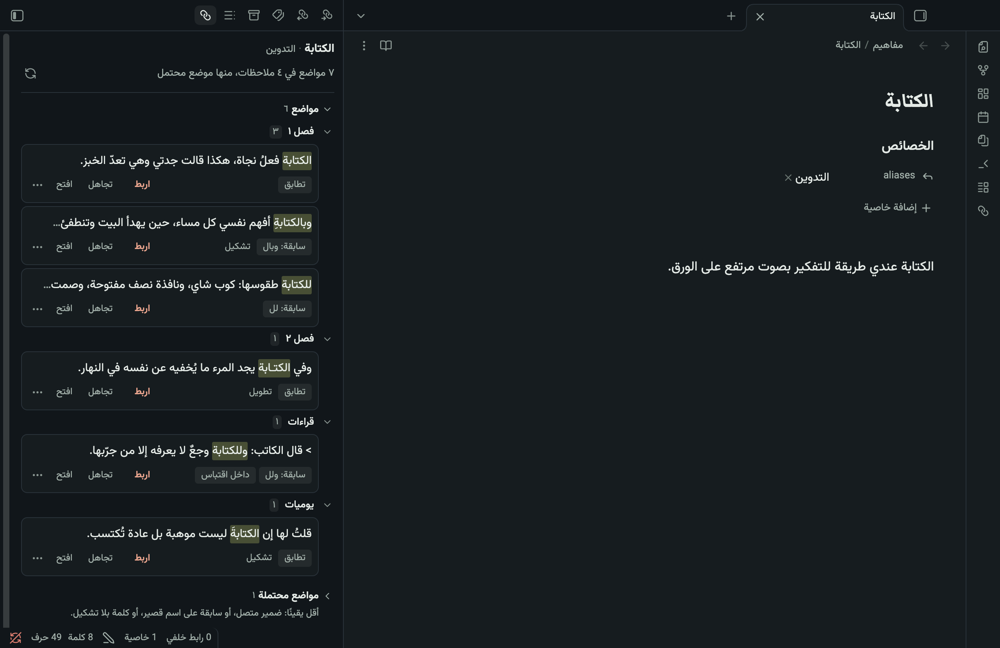
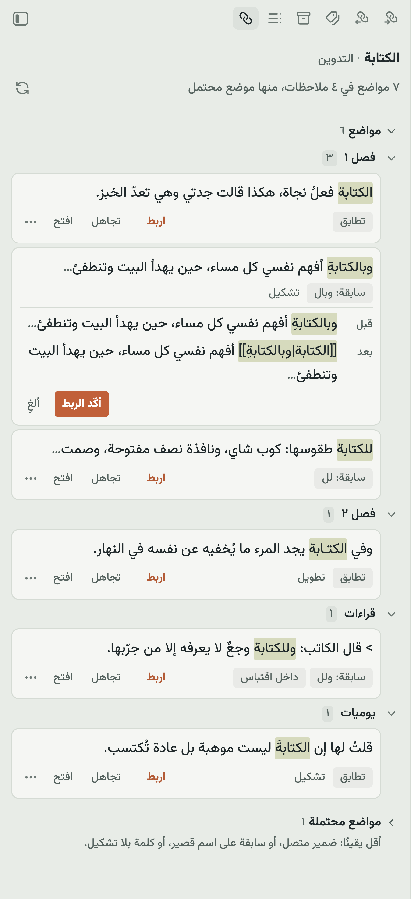

<h1 align="center">Wasl · وَصْل</h1>

<p align="center">An Obsidian plugin that finds where you mentioned a note's title without linking it, even when the Arabic is written with a prefix, diacritics or a tatweel, and links it only when you approve.</p>

<p align="center">
  <a href="LICENSE"></a>
  
  <a href="README.md">العربية</a>
</p>

## Why

You have a note titled «الكتابة» ("writing"). In other notes you wrote «وبالكتابةِ أفهم نفسي» ("and by writing I understand myself"), «للكتابة طقوسها» ("writing has its rituals") and «الكتـابة» with a tatweel. All of them mean that note, and you never linked any of them.

Obsidian's built-in *unlinked mentions* look for the name literally, so it catches none of the three. Wasl takes the note you have open, searches the rest of your vault for its title and aliases, and understands Arabic spelling variation. It shows each mention in its sentence together with the reason it matched, and you decide.

## How you use it

1. Open the note you want to see mentions of. Open the Wasl panel from the link icon in the sidebar, or with the command *Show unlinked mentions*.
2. Wasl searches and lists results grouped by the note they appear in. Each result shows its sentence with the word highlighted and why it was suggested: "prefix: وبـ", "tatweel", and so on.
3. Press **Link** to see a preview of the link as it will be written. If it looks right, press **Confirm link**; otherwise cancel. If you don't want this mention, press **Ignore** and it won't be suggested again (you can show what you ignored and stop ignoring it from the panel).
4. If you change your mind afterwards, the command *Undo last link* restores the sentence.

<p align="center"></p>

<p align="center"></p>

<p align="center"><sub>Two screenshots from a demo vault in the <a href="https://github.com/iSltanX/obsidian-khazaf">Khazaf</a> theme; every sentence was written for the demo.</sub></p>

Wasl writes to no file before you confirm, never links everything at once, and draws no underlines while you type. It works only when its panel is open.

### The link keeps your word as you wrote it

The link wraps the whole word, prefix included, and the word stays as its display text, so your sentence doesn't change:

```
وبالكتابةِ أفهم نفسي   →   [[الكتابة|وبالكتابةِ]] أفهم نفسي
```

The display text is written in every link, even when the word matches the title exactly (`[[الكتابة|الكتابة]]`). Obsidian drops the display text when it equals the title, and then renaming the note later changes the word inside your sentence.

## What it matches

Wasl compares only against your existing note titles and their aliases. It doesn't analyze the language at large and uses no AI. Every suggestion carries its reason.

| Kind | What is accepted | Example for a note «الكتابة» | Where it appears |
|---|---|---|---|
| Match | The same letters after ignoring diacritics, tatweel, invisible marks, copied PDF presentation forms, Arabic-Indic and Persian digits, Persian kaf and yeh, and Latin case | «الكتابةُ», «الكتـابة» | Mentions |
| Prefix or initial hamza | A prefix from a closed list: `و`/`ف`, then `ب`/`ك`/`ل`, then «ال», including «لل». And a dropped hamza at the start of a word (الانسان → الإنسان) | «وبالكتابةِ», «للكتابة» | Mentions |
| Indefinite (opt-in) | The word without «ال», only for a note you asked for it (see *Note options*) | «كتابة» | Mentions |
| Possible | An attached pronoun («ذاكرته» for a note «الذاكرة»), a one-letter prefix on a short name, or an unvocalized word for a vocalized title | «كتابتها» | The *Possible mentions* section, collapsed by default |

## Limits of the matching

Wasl doesn't promise to find every mention. These are its limits:

- **No roots, derivation, plurals or synonyms.** «كتب», «كتّاب» and «الكاتب» are not suggested for «الكتابة». Add any of them as an alias of the note. The reason: Arabic stemmers conflate different words («الكتابة» with «الكتاب»), and a wrong link is worse than a missed one.
- **No changes at the end of a word:** «على» and «علي», «كتابة» and «كتابه» stay different words. No mid-word hamza either: «سأل» and «سال».
- **Short names:** a two-letter name never loses a prefix («بجد» is not suggested for a note «جد»). A three-letter name with a one-letter prefix goes to *Possible*, because «وجود» may be «و + جود» or a word on its own.
- **Names with no letters, or Latin glued to punctuation,** such as «C++», can't be searched; the panel tells you to add an alias with letters.
- **Multi-word titles:** the prefix is accepted on the first word only, the other words must match as written with a single space between them, and a match never crosses a line break.
- **Accusative tanwin** («زيدًا» for a note «زيد») is outside the rules for now.
- **Deliberately skipped:** section headings (writing a link inside a heading breaks the links that point to it), code, existing links and embeds, math, comments, HTML, tags, footnotes, block IDs, and note properties. Quoted text is shown with a "inside a quote" label, and can be hidden in the settings.
- **Conflicting vocalization:** if you vocalize a note's title («الدَّرَج») it won't match «الدُّرج»; vocalizing signals that you want the distinction.
- **A limit in Obsidian itself:** in Markdown-style links (`[text](note.md)`), when the text equals the note's name exactly, Obsidian rewrites the text on rename. Wikilinks (`[[ ]]`) are unaffected.

### What was measured, and what wasn't

On Arabic test sentences locked before measuring, so the rules weren't changed afterwards, **83 of 84 suggestions were correct**. On real Arabic novel text with concept titles, Wasl was estimated to catch about **41%** of the correct mentions that Obsidian's built-in feature misses. Details are in [`docs/experiments/`](docs/experiments/) (Arabic).

Accuracy in daily use has not been measured in numbers. The project's author used it for a week on an iPhone and was happy with it, but that is an impression, not a measurement.

## Note options

Add what fits the note to its properties:

| Property | When | What it does |
|---|---|---|
| `wasl: exact` | Names of people | Only the name itself is accepted: no «ال», no prefix, no different hamza. A note «سلطان» won't catch «السلطان». |
| `wasl: indefinite` | Concept notes | Also catches the word without «ال»: a note «الكتابة» catches «أحب كتابة الرسائل». Don't enable it for a note about a thing («اللوحة», "the painting"), because «لوحة» is a common word. |
| `aliases` | Any note | Alternative names that Wasl searches for too. This is how you cover plurals and synonyms. |

## Settings

Under **Settings → Wasl**:

- **Excluded folders:** notes inside them aren't searched. One folder per line.
- **Possible mentions:** collapsed or hidden.
- **Mentions inside quotes:** shown with a label, or hidden.
- **First mention only:** show only the first mention in each note, and nothing from notes that already link the target.
- **Interface language:** Arabic or English; automatic follows Obsidian.

If Obsidian's *Automatically update internal links* setting is off, Wasl warns you: Obsidian asks before updating links when you rename or move a note, and renaming outside Obsidian breaks the links Wasl wrote.

## On mobile

Wasl is written to run on a phone: no Node, no external libraries, and its panel appears in the side drawer. It has been tried on an **iPhone** (Obsidian 1.14.4): search time, how the written links render in reading and editing, and a week of daily use. **Android** hasn't been tried yet, so there's no promise there.

## Privacy

Wasl doesn't connect to the internet and sends nothing to anyone. It reads your notes inside Obsidian and writes only what you confirmed. In the plugin's settings file on your device it keeps the list of what you ignored and number-only counters (how many were linked and rejected), with no note names and no text. The command *Export statistics to a note* writes these numbers to a new note if you want to see them.

## Installation

Until it is listed in Obsidian's community plugins:

1. Download `main.js`, `manifest.json` and `styles.css` from the [latest release](https://github.com/iSltanX/obsidian-wasl/releases).
2. Create a folder named `wasl` inside `.obsidian/plugins/` in your vault and put the three files in it.
3. Restart Obsidian, then enable "Wasl" under **Settings → Community plugins**.

## Development

Requires Node 20 or newer.

```bash
npm install
npm test
npm run build
```

`npm run dev` rebuilds on save. Code rules are in [`CONTRIBUTING.md`](CONTRIBUTING.md) (Arabic). The execution plan is in [`PLAN.md`](PLAN.md) and the feasibility study in [`docs/study.md`](docs/study.md), both in Arabic.

## License

[MIT](LICENSE).
